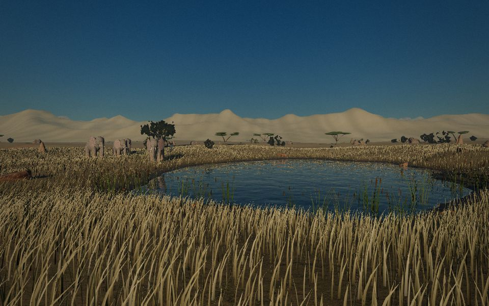

# 野境

在浏览器里第一人称走进一片 480 米见方的自然保护区：森林、湿地、开阔草原、雨林温室、昆虫花园、干旱岩地。

**▶ 在线玩：https://blondecs.github.io/yejing/**

- 斑马、长颈鹿、大象按钟点去饮水塘喝水，路边常碰到野兔、野鸡、灰雁、野猪、狐獴；远处山脚有角马在迁徙。
- 天气会自己变（晴、薄雾、小雨、雨后），有昼夜；清晨鸟合唱，正午蝉鸣，夜里蛙和蟋蟀。所有声音都是实时合成的。
- 岔路口有木头路牌，湿地有观鸟屋，草原有能爬上去的瞭望台。

## 怎么玩

| 按键 | 作用 |
|---|---|
| 点一下画面 | 开始（锁定鼠标） |
| W A S D | 走 |
| Shift | 跑（跑着冲过去动物才会躲） |
| 空格 / C | 跳 / 蹲下 |
| E | 观察看着的动物或植物 |
| N | 野外笔记本：手绘地图、找动物的钟点表、物种速写 |
| P | 拍照 |
| M | 微距，贴近昆虫，也能探进水里 |
| Esc | 放开鼠标；再按一次打开菜单（画质、小地图、帧率） |

## 需要什么

- 电脑上的 Chrome 或 Edge（支持 WebGPU；不支持时自动退回 WebGL2）。
- 第一次打开要下载约 300 MB，之后浏览器会缓存。
- 显卡较弱的笔记本，在菜单里把画质调到「低」。

## 素材

动物模型来自 Sketchfab，植物、石头和地面贴图来自 Poly Haven（扫描素材，CC0），作者和授权见 [CREDITS.md](CREDITS.md)。其中几个动物模型是 CC BY-NC（只能非商业使用），所以这个项目仅供非商业用途。

地形、草、天空、天气、水、温室和其他建筑、没有模型的动物和昆虫、一部分植物、全部声音，都是代码实时生成的。
